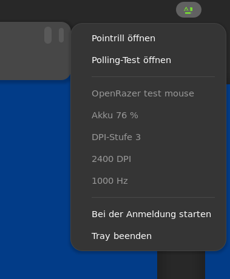

# Pointrill

[English](README.md)

Pointrill ist eine Linux-Anwendung für Mäuse und Empfänger, die OpenRazer unterstützt. Es erkennt angeschlossene Geräte und zeigt die jeweils verfügbaren Einstellungen.

## Funktionen

- DPI-Stufen, Pollingrate, Beleuchtungszonen, Scrollradmodi und unterstützte Empfänger-LEDs einstellen. Smart Reel und Scrollbeschleunigung setzen eine Modusauswahl mit Freilauf voraus.
- Die Helligkeit auf Aus oder eine von sechs Stufen stellen. Unter **Beleuchtung → Gerät** lassen sich alle verfügbaren Zonen gemeinsam einstellen.
- Akkustand und Ladestatus ansehen und, sofern verfügbar, Ruhezustand und Akkuwarnung einstellen.
- Änderungen als Vorschau prüfen und übernehmen, Profile speichern, frühere Einstellungen wiederherstellen und beim Spielstart automatisch das Profil wechseln.
- Mauseingaben testen und die empfangene Pollingrate sowie die CPU-Last live sehen.
- Das Tray zeigt DPI-Stufe und Akkubalken, wechselt Profile und bietet einen Schalter für den Autostart.
- Unter **System** stehen sechs Themes mit Vorschau und ein Schalter für den Tray-Autostart zur Auswahl.

### Tray-Screenshots

| KDE Plasma | GNOME |
| --- | --- |
|  |  |

[GNOME-Tray bei niedrigem Akkustand](docs/screenshots/tray-gnome-low-battery.png)

## Installation

Installiere und starte den OpenRazer-Treiber samt Daemon für dein Gerät. Lade das passende 64-Bit-Paket herunter. [Pointrill 0.4.7 herunterladen](https://github.com/ashrynsilkstone-ui/pointrill/releases/tag/v0.4.7)

| Distribution | Installationsbefehl |
| --- | --- |
| CachyOS | `sudo pacman -U ./pointrill-0.4.7-1-x86_64.pkg.tar.zst` |
| Fedora | `sudo dnf install ./pointrill-0.4.7-1.x86_64.rpm` |
| Debian und Ubuntu | `sudo apt install ./pointrill_0.4.7-1_amd64.deb` |

Öffne **Pointrill** im Anwendungsmenü.

### Tray und Autostart

Das Tray startet bei der nächsten Anmeldung in KDE Plasma oder GNOME.

Öffne unter GNOME die App **Erweiterungen** und aktiviere **AppIndicator and KStatusNotifierItem Support**. Unter Ubuntu kannst du die mitgelieferte Erweiterung **Ubuntu AppIndicators** einschalten. Falls du die Erweiterung erst installieren musst, findest du sie bei [GNOME Extensions](https://extensions.gnome.org/extension/615/appindicator-support/).

Im Tray-Menü kannst du **Bei der Anmeldung starten** umschalten. Im Terminal geht das mit `pointrill --enable-autostart` oder `pointrill --disable-autostart`. Mit `pointrill --tray` startest du das Tray in der laufenden Sitzung. Wenn du den Autostart vor Version 0.4.4 selbst aktiviert hast, aktualisierst du deinen persönlichen Eintrag für GNOME mit `pointrill --enable-autostart`.

Wenn du Pointrill selbst baust, brauchst du Rust ab Version 1.95. Installiere das Programm an einem festen Pfad, bevor du den Autostart aktivierst.

```sh
cargo build --locked --release
install -Dm755 target/release/pointrill ~/.local/bin/pointrill
~/.local/bin/pointrill --enable-autostart
```

### Optionaler USB-Zugriff

Einige Geräteeinstellungen benötigen direkten USB-Zugriff. Falls der Zugriff fehlt, installiere die optionale Regel und stecke das Gerät neu ein.

```sh
sudo install -Dm644 /usr/share/doc/pointrill/69-pointrill.rules /etc/udev/rules.d/69-pointrill.rules
sudo udevadm control --reload-rules
```

Im Quellcode findest du die Regel unter `packaging/69-pointrill.rules`.
