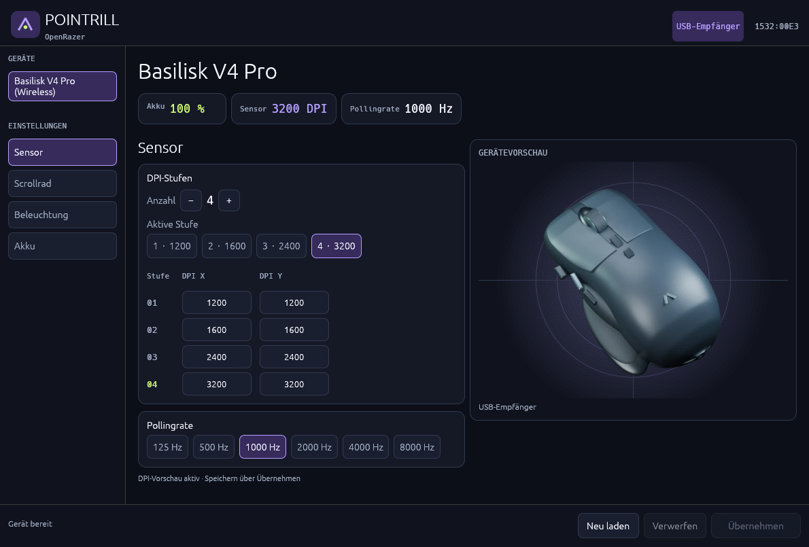

# Pointrill

[English](README.md)

Pointrill ist eine native Rust-App für Mäuse und Empfänger unter OpenRazer. Sie erkennt Geräte beim Start und beim Anschließen. Pro Gerät zeigt sie die Einstellungen an, die der jeweilige OpenRazer-Treiber bereitstellt.



- **Sensor** enthält DPI, DPI-Stufen und Pollingrate.
- **Beleuchtung** enthält die verfügbaren Effekte und Helligkeitsregler pro Zone.
- **Scrollrad** enthält die Radfunktionen des Geräts. Bei der Basilisk V4 Pro durchläuft die belegte Taste die gewählten Modi. Smart Reel und Scrollbeschleunigung stehen bei Kombinationen mit Freilauf zur Verfügung.
- **Akku und Dongle** zeigen Ladezustand, Ruhezustand, Akkuwarnung und unterstützte Status-LEDs.

Die Viper V4 Pro erscheint als Maus über USB (`1532:00E5`) oder mit ihrem HyperSpeed-Dongle (`1532:00E6`). Der Reiter **Dongle** erscheint, wenn Pointrill die LED-Modi auslesen kann. Die App verwendet dafür nach Möglichkeit OpenRazer. Mit der optionalen HID-Regel probiert sie zusätzlich die dokumentierten Befehle für diesen Empfänger. [OpenRazer-Geräteunterstützung](https://github.com/openrazer/openrazer/pull/2751) · [Messdaten zu den LED-Modi](https://github.com/openrazer/openrazer/issues/2760)

## Vorschau und Übernehmen

Änderungen erscheinen sofort im Fenster. Bei der Basilisk V4 Pro mit HID-Zugriff lässt sich auch die DPI direkt am Sensor vorführen. Beim Verwerfen oder normalen Schließen stellt die App den ursprünglichen DPI-Wert wieder her, sofern die Maus erreichbar ist und noch den Vorschauwert meldet.

Erst **Übernehmen** schreibt den Entwurf über die Speicherbefehle des Geräts oder über OpenRazer. Welche Werte nach dem Abziehen erhalten bleiben, hängt vom Gerät und Treiber ab. Pointrill liest die übernommenen Werte zurück und versucht bei einem Abbruch, bereits geänderte Werte wiederherzustellen.

## Start unter Linux

Du brauchst Rust ab Version 1.95, eine Wayland- oder X11-Sitzung mit OpenGL und den OpenRazer-Treiber samt Daemon für deine Distribution. Starte OpenRazer in deiner Desktop-Sitzung und führe im Projektordner aus.

```sh
cargo run --locked --release
```

Die aktive DPI-Stufe und die Pollingrate wählst du über direkte Tasten. Klick auf einen DPI-Wert, um ihn einzugeben, oder ziehe ihn, um ihn zu ändern. Mit `cargo run --locked -- --probe` listest du erkannte Geräte und ihre verfügbaren Einstellungen auf.


Die flüchtige DPI-Vorschau und die zusätzlichen Radfunktionen der Basilisk V4 Pro sowie der LED-Zugriff für den Viper-V4-Pro-Dongle nutzen USB-Schnittstelle 03. Fehlt der Zugriff, installiere die optionale Regel und stecke das Gerät neu ein.

```sh
sudo install -Dm644 packaging/69-pointrill.rules /etc/udev/rules.d/69-pointrill.rules
sudo udevadm control --reload-rules
```

## Teststand

Privater Teststand. Die Basilisk V4 Pro wurde unter CachyOS über HyperSpeed geprüft. Bei der DPI-Vorschau und beim Verwerfen blieben die gespeicherten Stufen erhalten. Änderungen der Pollingrate erreichten die Maus erst bei **Übernehmen**. Danach wurde der Ausgangswert wiederhergestellt. Der OpenRazer-Simulator lieferte 123 Maus-Endpunkte, die Pointrill alle erkannte. Dazu gehörten die Viper V4 Pro per Kabel und per Empfänger. Die LEDs des Viper-V4-Pro-Dongles wurden mit simulierten HID-Antworten getestet. Der Test an einem physischen Viper-Dongle steht noch aus.

```sh
cargo test --locked
```
