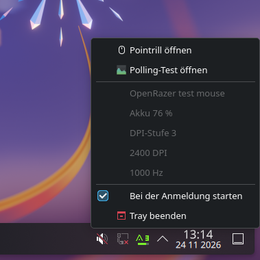
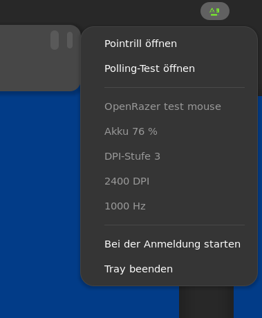

# Pointrill

[Deutsch](README.de.md)

Pointrill 0.4.7 is a Rust desktop app for mice and receivers supported by OpenRazer on Linux. It detects connected devices and shows the controls each device supports.

## Features

- Adjust DPI stages, polling rate, lighting zones, scroll wheel modes and supported receiver LEDs. Smart Reel and scroll acceleration require a wheel-mode selection that includes free spin.
- Set brightness to Off or one of six levels. Under **Lighting**, use the device brightness control to set all available zones together.
- View battery and charging status, and adjust idle time and low-battery warnings where supported.
- Preview and apply changes, save profiles, restore previous settings and switch profiles automatically when games start.
- Test mouse input and see the received polling rate and CPU load live.
- The tray shows the DPI stage and a battery bar, applies profiles and provides an autostart toggle.
- Under **System**, choose from six themes with a preview and switch tray autostart on or off.

### Tray screenshots

| KDE Plasma | GNOME |
| --- | --- |
|  |  |

[GNOME tray at low battery](docs/screenshots/tray-gnome-low-battery.png)

## Installation

Install and start the OpenRazer driver and daemon for your device. Download the matching 64-bit package. [Pointrill 0.4.7 downloads](https://github.com/ashrynsilkstone-ui/pointrill/releases/tag/v0.4.7)

| Distribution | Install command |
| --- | --- |
| CachyOS | `sudo pacman -U ./pointrill-0.4.7-1-x86_64.pkg.tar.zst` |
| Fedora | `sudo dnf install ./pointrill-0.4.7-1.x86_64.rpm` |
| Debian and Ubuntu | `sudo apt install ./pointrill_0.4.7-1_amd64.deb` |

Open **Pointrill** from the application menu.

### Tray and autostart

The packages start the tray at your next KDE Plasma or GNOME login.

On GNOME, open the **Extensions** app and enable **AppIndicator and KStatusNotifierItem Support**. On Ubuntu, enable the bundled **Ubuntu AppIndicators** extension if it appears in the list. If you need to install the extension first, get it from [GNOME Extensions](https://extensions.gnome.org/extension/615/appindicator-support/).

Use the tray menu to change autostart for your account. You can also run `pointrill --enable-autostart` or `pointrill --disable-autostart`. Use `pointrill --tray` to start the tray in the current session. If you enabled autostart before 0.4.4, run `pointrill --enable-autostart` again to update your personal entry for GNOME.

For a source build, use Rust 1.95 or later. Install the binary at a stable path before enabling autostart.

```sh
cargo build --locked --release
install -Dm755 target/release/pointrill ~/.local/bin/pointrill
~/.local/bin/pointrill --enable-autostart
```

### Optional USB access

Some device controls require direct USB access. If access is missing, install the optional rule and reconnect the device.

```sh
sudo install -Dm644 /usr/share/doc/pointrill/69-pointrill.rules /etc/udev/rules.d/69-pointrill.rules
sudo udevadm control --reload-rules
```

For a source build, the rule is in `packaging/69-pointrill.rules`.
